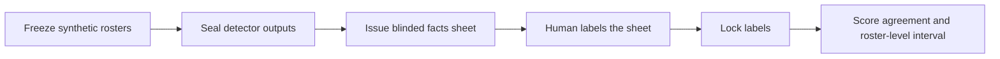

# ED Roster Gap Lab

A small, auditable Python workbench for checking explicit rules on synthetic emergency-department rosters and preparing a blinded comparison with one human rater.

**This release is software and a study protocol. The human agreement study is pending.** Every bundled rule value is hypothetical. The demonstration uses a simulated rater. There are no real staff records, patient records, clinical outcomes, or claims that the detector can replace clinical judgment.

## Run the complete example

Python 3.10 or newer; Python standard library only. No model, API key, account, model download, or network service is needed. From the project folder:

```sh
python -B run_ed_ii.py verify
python -B run_ed_ii.py demo
python -B run_ed_ii.py checks
```

On Windows, `py -3` can replace `python`. Each demo/check run gets its own folder under `runs/`. Open its `DEMO-REPORT.md` or `TRACK-II-CHECKS-*.json`. The launcher refuses to run when a file differs from the release manifest, and returns failure if a tracked file changes during execution.

[v0.1.0 results](docs/RESULTS.md) · [Methods](docs/METHODS.md) · [Limitations](docs/LIMITATIONS.md) · [v0.1.0 paper (PDF)](paper/MANUSCRIPT.pdf) · [Manuscript source](paper/MANUSCRIPT.md) · [Correction record](docs/CORRECTIONS.md) · [Independent review](docs/INDEPENDENT-REVIEW.md) · [Security](SECURITY.md)

The paper and numerical evidence retain the reviewed v0.1.0 snapshot. Later file-safety and input-validation corrections have separate [audit evidence](docs/SECURITY-AUDIT.md); they do not rewrite the earlier results or supply missing human judgments.

## What this demonstrates

- A deterministic rule engine with findings tied to a staff token, day, shift, and rule.
- Constructed legal and illegal examples, boundary tests, and tests that must catch deliberately planted defects.
- A measurement workflow that seals detector outputs before issuing a label sheet, locks labels before scoring, and rejects later edits.
- Honest separation of software correctness, simulated agreement, and the still-missing human evidence.



The demo replaces the human step with an explicitly named `SIMULATED` heuristic and must use `--pipeline-test` to score it. It never writes a founder label.

## Check one roster

```sh
python -B run_ed_ii.py detect --rules rules/RULES.test-H2-H4.json --input fixtures/CONSTRUCTED-ILLEGAL-PC-01.json
```

Exit `0` means evaluation completed; inspect `findings` to see violations. Exit `3` means no evaluation ran. Exit `2` means an input or command error. Exit `4` means release integrity failed. The founder template returns `NOT_RUN` because its rules are unset.

`detect --out` requires a new output file. Measurement label sheets are issued once and never overwrite an existing CSV. Keep one operator per set and use a new set for changed study choices. Shift names are short letter-led tokens such as `DAY` or `NIGHT`.

| Rule | Implemented check |
|---|---|
| H1 | RN count against the selected census-band minimum |
| H2 | At least one charge-qualified RN on a shift |
| H4 | Assignments that conflict with stated unavailability and allowed exceptions |
| H5 | Rest from shift end to the next start; optional day-after-night prohibition |
| H6 | Consecutive-work limit, with an explicit calendar-day or shift count choice |
| H9 | Assignments to separate places in the same block |

H8 has a limited **hypothetical** orientee/preceptor branch. H3, H7, and H10 are declared interfaces without implementations. Read the exact [capability limits](docs/LIMITATIONS.md).

## What remains to finish the original study

The original endpoint is detector-versus-founder judgment agreement with an interval. It requires reviewed staffing rules, prespecified measurement choices, and genuine labels made before unblinding. Those inputs are absent. The [input sheet](docs/FOUNDER-INPUTS.md) consolidates what is missing; the [protocol](docs/PROTOCOL.md) describes the sequence. A software release does not complete that endpoint.

## Project layout

| Path | Purpose |
|---|---|
| `detector/`, `rules/`, `fixtures/` | Rule engine, unset founder template, constructed test inputs |
| `measure/` | Reproducible roster generation, sealing, label locking, agreement |
| `tests/` | Regression and planted-defect checks |
| `demo/` | Two hypothetical branches using the same simulated labels |
| `docs/`, `paper/` | Methods, limitations, reproducible result tables, protocol, manuscript |
| `tools/` | Test runner, evidence renderer, intentional manifest regeneration |

The code continues the Track (ii) workbench built in October 2026. This portable edition corrects integrity enforcement, mutation accounting, frozen-set reuse, and incomplete-rule scoring. See [provenance](docs/PROVENANCE.md). MIT licensed; see [LICENSE](LICENSE).
